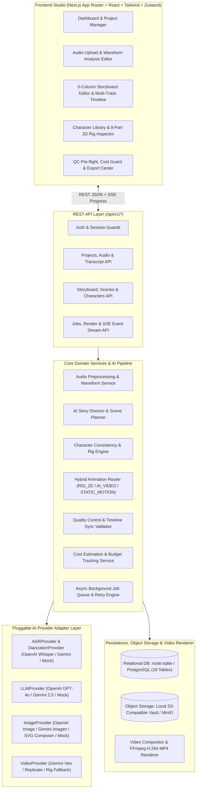

# DARKTOON AI — System Architecture (`ARCHITECTURE.md`)

## 1. High-Level Architecture Overview

**DARKTOON AI** is built as a modular, production-ready application following Clean / Layered Architecture principles. To run seamlessly out-of-the-box on Windows/Linux/macOS with only Node.js v26+ while also supporting containerized PostgreSQL + Redis + FastAPI/Worker deployments via Docker Compose, the system separates UI, REST API (`/api/v1/*`), Domain Services, AI Provider Adapters, Background Job Worker Queue, Storage Engine, and Hybrid Rendering Engine into strict layers.



---

## 2. Directory Structure

```text
darktoon-ai/
├── src/
│   ├── app/                          # Next.js App Router (Frontend Studio + /api/v1 REST endpoints)
│   │   ├── api/v1/                   # Structured REST API routes matching PRD Section 8
│   │   └── ...                       # Studio Workspace UI
│   ├── components/
│   │   ├── audio/                    # Audio Uploader, Waveform Visualizer, Transcript & Diarization Editor
│   │   ├── storyboard/               # 3-Column Storyboard Editor, Scene List, Scene Properties Inspector
│   │   ├── animation/                # Articulated 8-Part 2D SVG Character Rig & Scene Stage Player
│   │   ├── timeline/                 # Multi-Track Timeline (Audio, Scene, Rig, Subtitles, Music, SFX)
│   │   ├── characters/               # Character Library, Expression/Action Tester, Lock Controls
│   │   ├── assets/                   # Versioned Asset Library Browser
│   │   ├── render/                   # QC Checklist, Cost Breakdown, Render Progress & MP4 Player
│   │   └── settings/                 # AI Provider Adapter Config & Project Settings
│   ├── backend/                      # Clean Modular Backend Architecture
│   │   ├── db/                       # Database Connection, Schema Migrations & Seed Data
│   │   ├── repositories/             # Data Access Layer for all 18 tables
│   │   ├── providers/                # Pluggable AI Adapters (Interfaces + OpenAI + Gemini + DevMock)
│   │   ├── services/                 # Business Logic (Audio, StoryDirector, Character, AnimationRouter, QC, Cost)
│   │   ├── animations/               # 2D Rig Presets (10 Expressions, 17 Actions, 11 Backgrounds, Camera Keyframes)
│   │   ├── rendering/                # Frame Synthesizer & FFmpeg H.264 MP4 Video Compositor
│   │   ├── storage/                  # Object Storage Service with Project Ownership Isolation
│   │   └── workers/                  # Async Background Job Processor with Retry/Cancel/Resume
│   ├── stores/                       # Zustand State Management for Studio UI
│   └── types/                        # Shared TypeScript & Zod Validation Schemas
├── migrations/                       # SQL Migrations (SQLite & PostgreSQL DDL)
├── storage/                          # Local S3-Compatible Object Storage Root (gitignored binaries)
├── tests/                            # Automated Integration & Unit Test Suite
├── docs/                             # PRD.md, ARCHITECTURE.md, IMPLEMENTATION_PLAN.md
├── docker-compose.yml                # Multi-container Postgres + Redis + MinIO + App deployment
└── .env.example                      # Environment variable template
```

---

## 3. Pipeline State Machine

Every project progresses through deterministic, resumable pipeline states:
1. `UPLOADED` — Original audio stored and validated.
2. `PREPROCESSING` — Audio metadata, duration, sample rate, and waveform peaks extracted without mutating original audio.
3. `TRANSCRIBING` — ASR extracts timestamped segments and word timings.
4. `DIARIZING` — Speakers identified (`SPK_1`, `SPK_2`, etc.) and mapped to dialogue turns.
5. `ANALYZING` — LLM extracts story summary, emotional arc, narrative segments, and character candidates (strictly distinguishing explicit facts vs. contextual inference vs. visual metaphor).
6. `GENERATING_STORYBOARD` — AI Story Director generates semantic scenes tied to exact audio timestamps.
7. `GENERATING_CHARACTERS` — Creates or links persistent `CharacterProfile` records with 8-part rig definitions.
8. `GENERATING_IMAGES` — Generates/composes scene visual layers and background assets with version tracking.
9. `GENERATING_ANIMATION` — `AnimationRouter` assigns `RIG_2D`, `AI_VIDEO`, or `STATIC_MOTION` and builds animation clips.
10. `READY_FOR_REVIEW` — User inspects, edits, approves, or regenerates individual scenes.
11. `RENDERING` — Pre-flight QC runs; compositor + FFmpeg renders synchronized H.264 MP4 video.
12. `COMPLETED` / `FAILED` — Output video stored as versioned asset or structured error logged for retry.

---

## 4. Provider Adapter Architecture & Honesty Policy

All AI operations go through strict TypeScript interfaces in `src/backend/providers/interfaces.ts`:
- `ASRProvider`: `transcribe()`, `getWordTimestamps()`, `detectLanguage()`
- `DiarizationProvider`: `diarize()`, `mapSpeakers()`
- `LLMProvider`: `analyzeStory()`, `generateStoryboard()`, `reviseScene()`, `validateScene()`
- `ImageProvider`: `generateImage()`, `generateCharacterReference()`, `generateAsset()`
- `VideoProvider`: `imageToVideo()`, `getJobStatus()`, `downloadResult()`
- `TTSProvider`: `generateVoice()`, `generatePreview()`

**Strict Configuration Rule:**
- When a real provider (`openai`, `gemini`, `replicate`) is selected without a valid API key, its status is reported as `NOT_CONFIGURED` in `/api/v1/providers/status` and in the UI header/settings, and calling it returns a structured `PROVIDER_NOT_CONFIGURED` error rather than faking real AI output.
- For development, testing, and instant evaluation without paid keys, users can explicitly enable **Development Mock Mode (`mock`)**, which processes real audio durations and transcripts while clearly marking every generated record and UI badge with `[MOCK]`.

---

## 5. Hybrid 2D Animation & Video Rendering Engine

1. **Articulated 2D Character Rig (`RIG_2D`):**
   - Built with 8 independent controllable body groups (`Head`, `Body`, `Left Arm`, `Right Arm`, `Left Leg`, `Right Leg`, `Eyes`, `Mouth`).
   - Supports 10 expressions (`neutral`, `happy`, `sad`, `angry`, `surprised`, `confused`, `worried`, `tired`, `thinking`, `crying`) combinable with 17 actions (`idle`, `walking`, `running`, `sitting`, `standing`, `looking_left_right`, `looking_down`, `turning_head`, `waving`, `holding_phone`, `using_phone`, `opening_door`, `closing_door`, `lying_down`, `falling`, `pointing`, `talking`).
2. **Animation Decision Engine (`AnimationRouter`):**
   - Evaluates scene action complexity, number of interacting characters, and symbolic camera requirements.
   - Defaults to `RIG_2D` for character consistency and cost efficiency; selects `STATIC_MOTION` for atmospheric pan/zoom beats; selects `AI_VIDEO` only for complex multi-character or metaphorical sequences, with automatic fallback to `RIG_2D` if `AI_VIDEO` is unconfigured or fails.
3. **FFmpeg MP4 Renderer (`VideoRenderService`):**
   - Synthesizes scene visuals + character rig poses + camera movement + optional subtitles, mixes the untouched master audio with optional background music/SFX at ducked volume, and encodes a standard `.mp4` (`libx264`, `aac`, `yuv420p`) playable in all browsers and social platforms.
